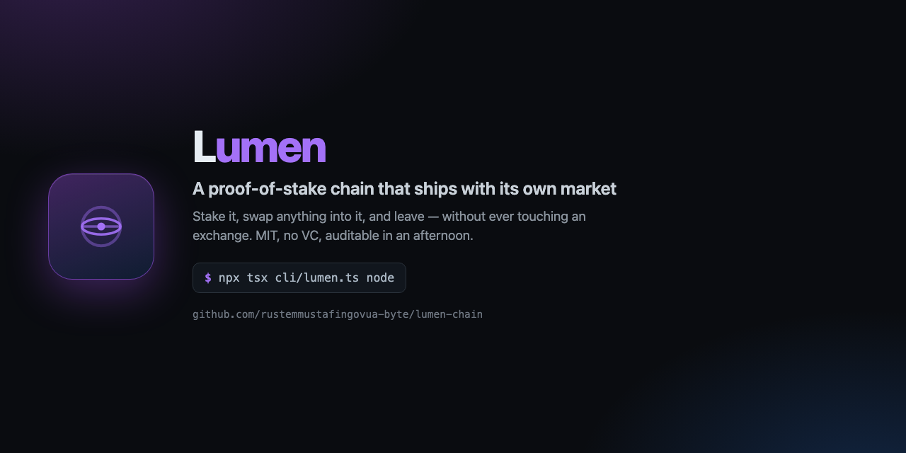
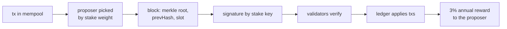

<div align="center">



# Lumen

**A proof-of-stake chain that ships with its own market — so you can hold value, stake it, and swap anything into it without ever touching an exchange.**

[](https://github.com/rustemmustafingovua-byte/lumen-chain/actions/workflows/ci.yml)
[](./LICENSE)
[](https://nodejs.org)
[](https://base.org)

[Docs](docs/) · [Architecture](docs/ARCHITECTURE.md) · [Tokenomics](docs/TOKENOMICS.md) · [Funding](docs/FUNDING.md) · [Threat model](docs/THREAT-MODEL.md) · [Issues](https://github.com/rustemmustafingovua-byte/lumen-chain/issues)

</div>

---

## The problem this solves

Every crypto project assumes two things that are not guaranteed: that an
exchange will list your token, and that your users will tolerate one. Lumen
removes both assumptions:

1. **The market is part of the protocol.** The AMM lives in the chain, so
   LMN/USDC liquidity exists from block one. No listing, no CEX listing fee,
   no withdrawal freeze.
2. **The keeper is the exchange.** A small daemon watches your treasury and
   converts whatever arrives — USDC, ETH, any supported asset — into LMN
   automatically, and sells LMN back when you want to leave. You never open an
   exchange account.
3. **The chain is yours.** MIT, no VC, no foundation above you. A validator
   set you control, a ledger you can read line by line, and a mining
   equivalent that costs nothing but a stake.

## What is in the box

| Component | What it does |
|---|---|
| `core/` | the chain: ed25519 accounts, PoS consensus, Merkle blocks, pool, AMM, JSON-RPC |
| `cli/` | `lumen` — wallet, node, transfers, staking, swaps, explorer |
| `keeper/` | the autonomous converter: any asset → LMN, and back, without an exchange |
| `contracts/` | LMN as an ERC-20 on Base plus the on-chain AMM, for liquidity where the liquidity is |
| `docs/` | architecture, tokenomics, funding model, threat model |

## Install

```bash
# tarball из релиза: без токена и без npm-логина
npm i -g https://github.com/rustemmustafingovua-byte/lumen-chain/releases/download/v0.1.0/lumen-chain-0.1.0.tgz
lumen explorer
```

<details>
<summary>Через GitHub Packages (нужен токен со scope read:packages)</summary>

```bash
npm i -g @rustemmustafingovua-byte/lumen-chain --registry=https://npm.pkg.github.com
```

</details>

## Quickstart


```bash
git clone https://github.com/rustemmustafingovua-byte/lumen-chain
cd lumen-chain && npm install && npm test
```

```bash
npx tsx cli/lumen.ts wallet new     # create a wallet
npx tsx cli/lumen.ts node            # run a validator node
npx tsx cli/lumen.ts balance lmn1…   # read a balance
npx tsx keeper/keeper.ts scan        # what the keeper sees
```

## How a block is made



- **Consensus**: proof of stake, stake-weighted, deterministic proposer per slot.
- **Finality**: a block is final once 2/3 of the stake has seen it.
- **Signatures**: ed25519 (RFC 8032), addresses are base58check with an `lmn` prefix.
- **Fees**: flat per transaction, no gas market to game.
- **Genesis**: 1e9 LMN minted deterministically — 60% to the treasury, 40% to an early-validator pool that pays 1:1 to the first stakers.
- **Native AMM**: constant product (x·y=k), 0.3% to liquidity providers.

## Tokenomics

| | |
|---|---|
| Supply | 1,000,000,000 LMN, fixed, no mint after genesis |
| Emission | 3% per year to validators, halving every 4 years |
| Minimum stake | 10,000 LMN |
| Transaction fee | 0.001 LMN |
| AMM fee | 0.30% to LP |
| Premine | 60% to the treasury, 40% to an early-validator pool that pays 1:1 to whoever stakes first |

Full detail: [docs/TOKENOMICS.md](docs/TOKENOMICS.md).

## The keeper: value without exchanges

```
incoming USDC/ETH  →  keeper  →  Uniswap V3 / LumenAMM  →  LMN  →  your Lumen address
LMN                 →  keeper  →  sell back to USDC        →  your Base address
```

The keeper is a normal process with a key. Run it on any machine with a Base
RPC endpoint; it is not a company, it is code, and anyone can run one against
their own treasury.

## Funding the project

Lumen is MIT and community-funded. The project accepts:

- **USDC on Base** → `0x8aC6a229f254980CCd3Dd35CF5E1B7c08880B40E`
- **GitHub Sponsors** → [sponsor](https://github.com/sponsors/rustemmustafingovua-byte)
- **Bounties** on issues labelled 💰 Reward — paid to whoever's PR lands

See [docs/FUNDING.md](docs/FUNDING.md) for the model and the numbers.

## Contributing

```bash
npm test        # 10 tests: signatures, nonces, blocks, staking, AMM, RPC
npm run lint
```

Adding a feature means one file in `core/` and a test. The chain is small on
purpose: it should be auditable in an afternoon.

## License

MIT © rustemmustafingovua-byte
